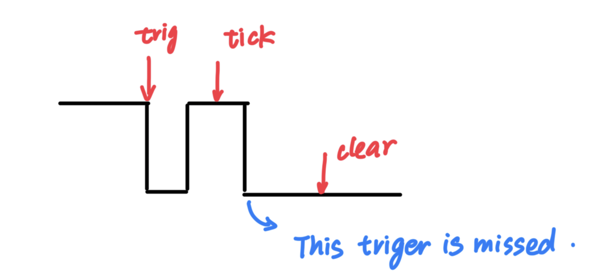
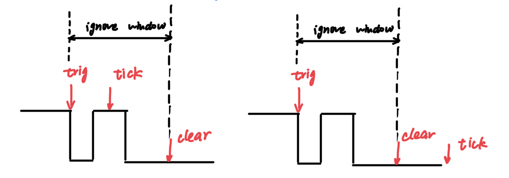

# STM32 Learning

This repository is dedicated to learning and experimenting with STM32 microcontrollers along side ATK's STM32 lectures.
However, this repository doesn't use Keil IDE or STM32CubeIDE, instead it uses arm-none-eabi-gcc toolchain and modern CMake build system to build different targets for each lab.  
The logic for each device is abstracted into library `components`, which is independent of the platform and can be reused in other projects. To use those components, in `bsp` we only need to implement interfaces defined in each component's header file, thus separate IO logic from the application logic.  
Then we can test those components, i.e. code logic in a host environment, and use them in embedded environment without any modification. After flashing firmware to STM32 devices, we only need to focus hardware IO status.  
Those tests are driven by GitHub Actions automatically.

This repo is create from [this template](https://github.com/Nightmare-ing/stm32-template.git), and there's description in README for the repo structure.

## Tests

## Labs

### Lab 2.1: Button to LED

In this lab, we use one button to control one LED. When the button is pressed, the LED will turn on, and when the button is pressed again, the LED will turn off.
We use state machine to debounce the button, instead of using delay.

### Lab 2.2: Button to LED through Interrupt

In this lab, we use one button to control one LED through interrupt. When the button is pressed, the LED will turn on, and when the button is pressed again, the LED will turn off.
I didn't use `HAL_GPIO_EXTI_IRQHandler` and `HAL_GPIO_EXTI_Callback` to handle the interrupt, because those two functions expose the GPIO hardware details to the application layer.
Instead I only use `board_key_handle_it` to clear the interrupt flag for specific button passed in, and then implement `EXTI2_IRQHandler` in `main.c` to call `board_key_handle_it` and implement the logic in `main` function.

It's a pitfall that the interrupt handler `EXTI2_IRQHandler` still exposes some low layer details, but that's the best way I can think of.
To use buttons in interrupt mode, we need to follow the steps below:

- Create a static button struct with `static struct butn key2`
- Bind this struct with the button adapter on specific board, e.g. `board_key_bind(BOARD_KEY_2, &key2);`
- Enable the interrupt for this button, e.g. `board_key_enable_it(&key2, 2, 0)`
- Implement the interrupt handler for the specific EXTI line, e.g. `EXTI2_IRQHandler`
  - In the interrupt handler, call `board_key_handle_it(&key2)` to clear the interrupt flag for this button
  - Implement the logic in `main` function, e.g. toggle the LED when the button is pressed.

In this lab we still use state machine to debounce the button. The idea is that, because we still can read the state of the button in interrupt mode, we use interrupt as a trigger to read the state of the button with debounce logic.

- If interrupt is triggered, we start to count with ticks
- Once the ticks reach a threshold, we tick the button with `butn_tick` to update the state of the button
  - After the state is updated, we can reset `butn_triggered` to false. Otherwise this trigger will be ignored before syncing this trigger into the state of the button.
  - We must clear `butn_triggered` before `butn_tick`, according to concurrency principle "Clear-Before-Check". Otherwise, if the button is triggered again after `HAL_GPIO_ReadPin` but before `butn_tick` returns, we'll miss this trigger, as is shown in the following figure
- Because the state of the button is updated, we can continue to count another threshold to check if the button is pressed or released. During this period, we can ignore the interrupt triggered by the button.
- If some butten event is detected, we can handle it in the main function, e.g. toggle the LED.

When handling interrupts, we need to be careful about the concurrency issues, especially the "ignore window". For example, in the following figure, between `trig` and `clear` it's the "ignore window". If we read inside this window, we may miss the newest trigger. But if we read outside this window, where the trigger won't be ignored, we can read the freshest trigger.

